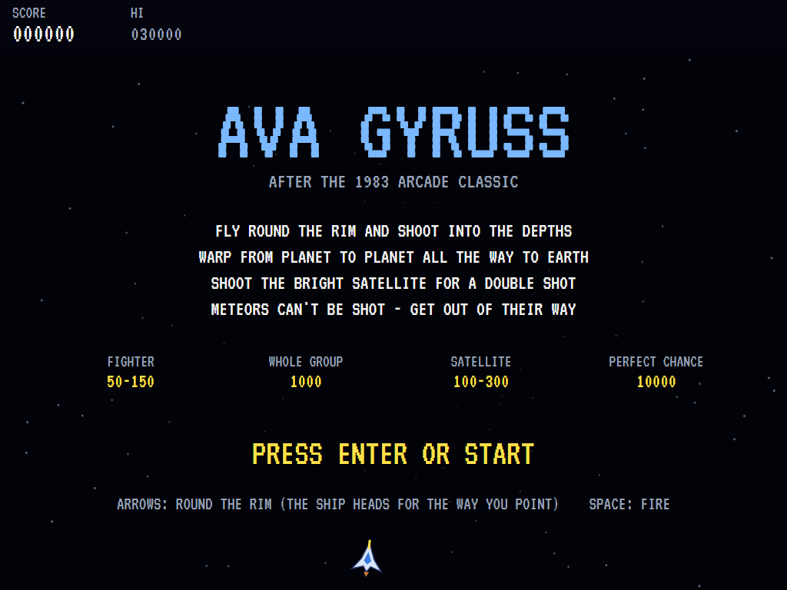
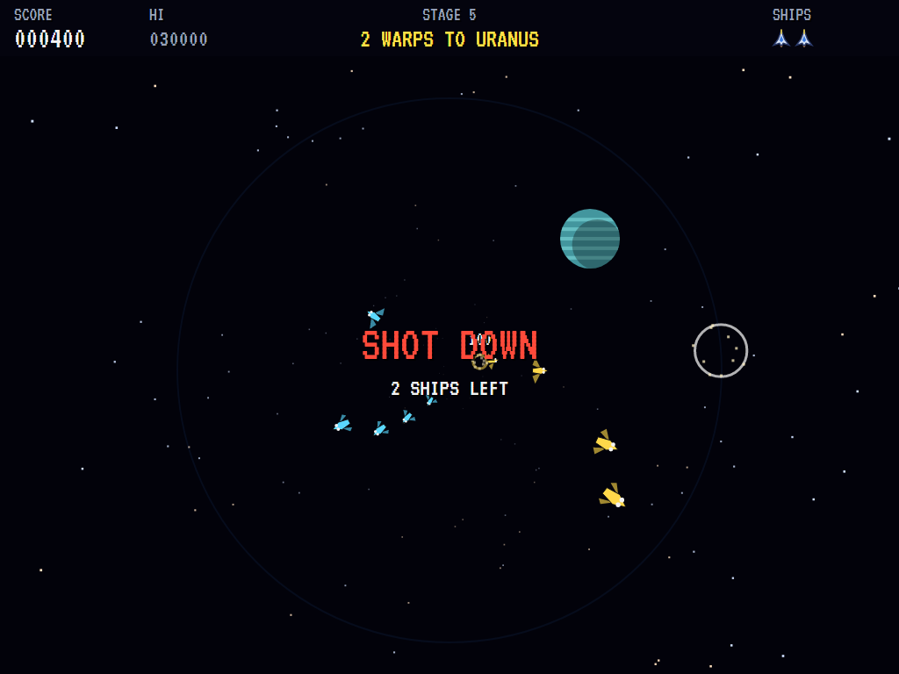
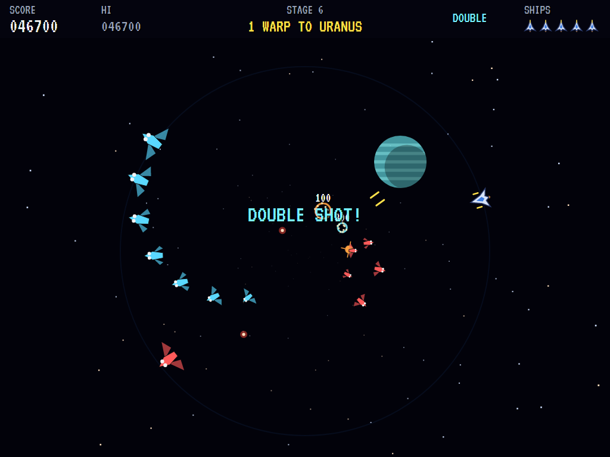
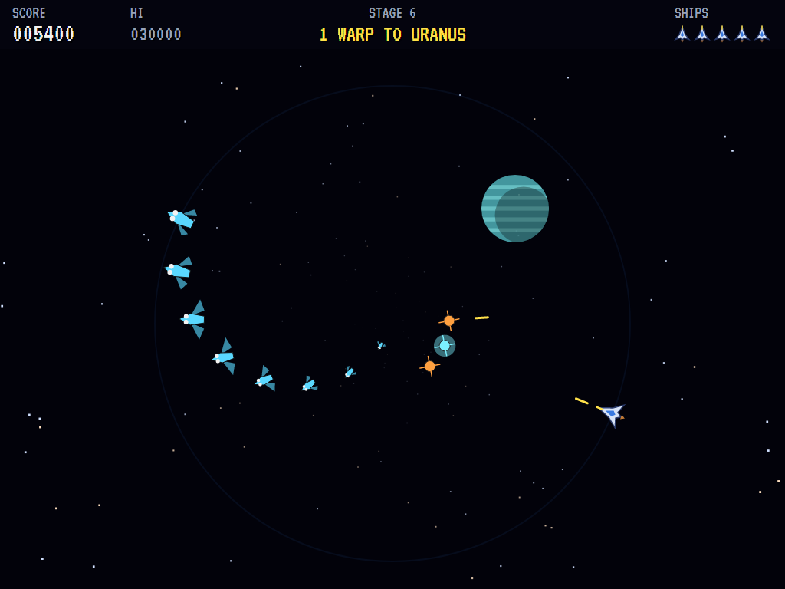
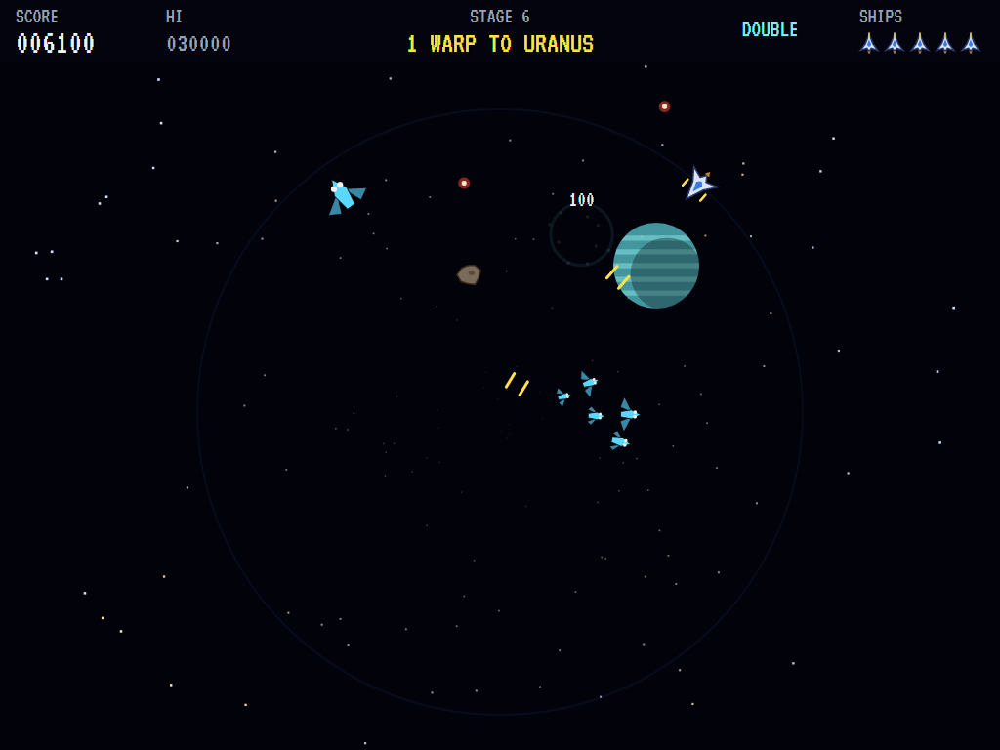
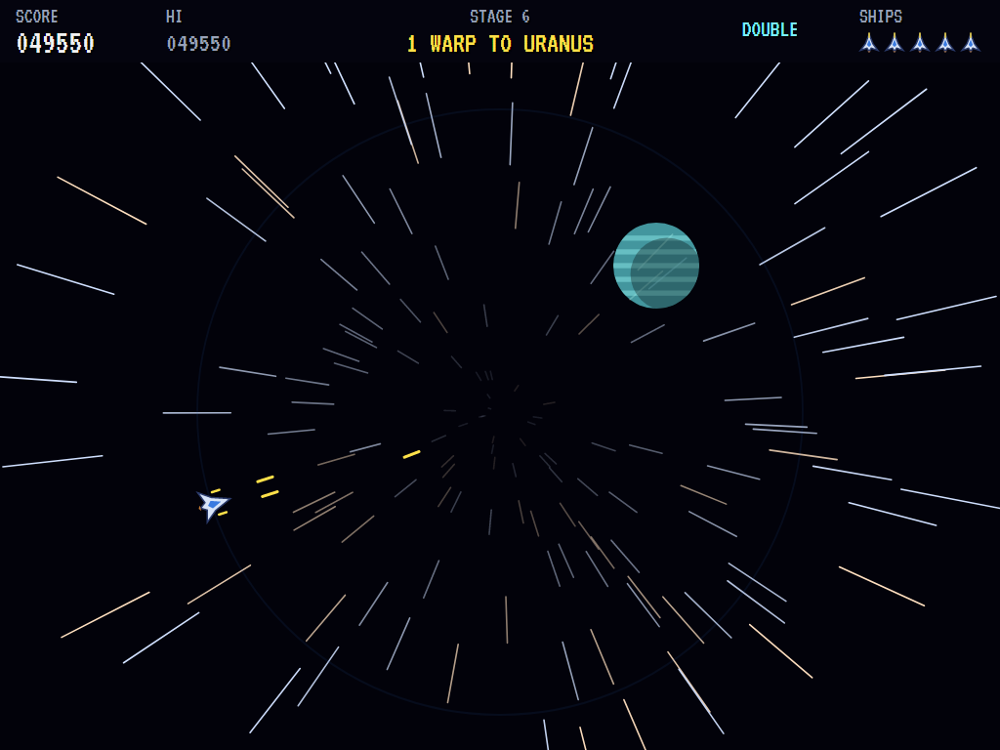
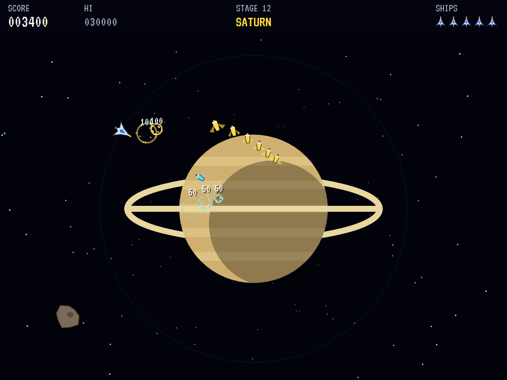
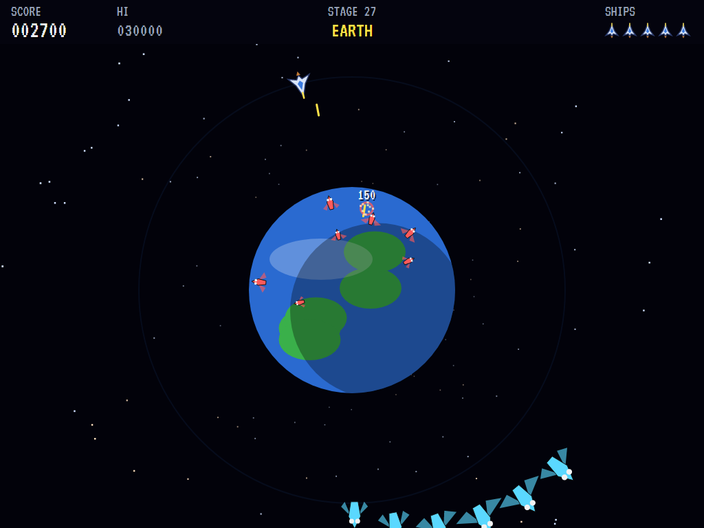
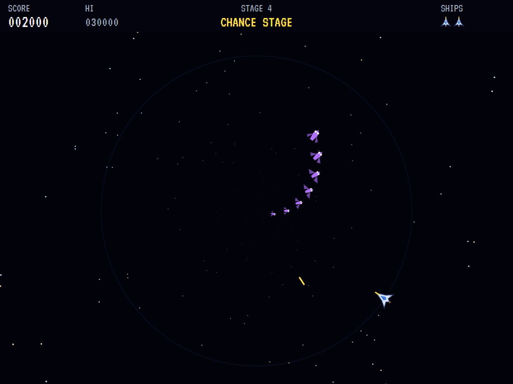
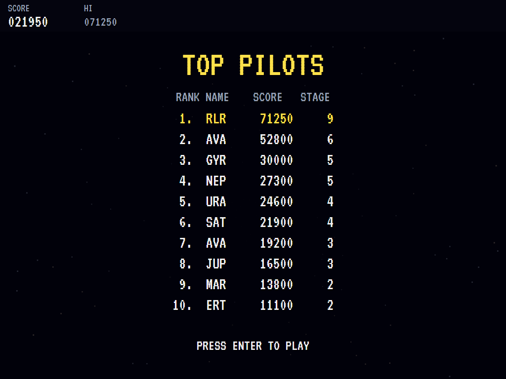

# AVA Gyruss

[](https://github.com/Harlock123/AVAGyruss/actions/workflows/build.yml)

A tube shooter in the style of Konami's 1983 arcade game **Gyruss**, built with .NET 10 and Avalonia UI.
The ship circles the rim of the screen and fires into the depths of space. Squadrons of fighters spiral
out of the distance, form up at the centre and dive at it. Warp from planet to planet, Neptune to Earth,
with a chance stage after every planet, all to a driving arrangement of Bach's Toccata in D minor.

## Features

- **The ship**:
  - **Flying:** it sweeps round the rim towards whichever way the stick points, the short way round, and stops when you let go.
  - **Firing:** shots fly into the centre, and get smaller as they go.
- **The squadrons**:
  - **Arriving:** groups of eight arrive one after another. Some spiral in from beyond the rim. Others loop out of the depths and back.
  - **The formation:** they settle into a ring of rings at the centre that slowly turns and breathes, firing out now and then.
  - **Diving:** fighters peel off and dive at the ship, firing as they come. Only a diver can ram the ship; the squadrons sweeping in from behind fly over it.
  - **Leaving:** if you take too long, the ones left fly off.
- **Satellites**: on every other stage three satellites gather near the centre. Shoot the bright one in the middle for a **double shot**, which lasts until the ship is lost.
- **Meteors**: from the third stage, meteors rush out of the depths towards the ship. They can't be shot; they only soak up your shots, so get out of their way.
- **The route**:
  - **The warps:** two warps to Neptune, then Neptune itself, then two warps each to Uranus, three each to Saturn, Jupiter, Mars and Earth.
  - **The view:** the next planet grows on each warp and fills the screen when you arrive. Clear the fighters and the stars streak past as the ship warps on.
  - **Going round again:** after Earth the route starts again, faster.
- **Chance stages**: after every planet, forty fighters fly past without firing. Shoot them all for a bonus of 10,000, or 100 for each hit.
- **Scoring**:
  - Fighters 50 in the formation, 100 on the way in, 150 diving
  - A whole squadron 1,000 (2,000 at a planet)
  - Satellites 100, the bright one 300
  - An extra ship at 30,000 and every 70,000 after that
- **Sound**:
  - **The music:** an original, driving arrangement built on the Toccata's opening figures (Bach, public domain), and the opening itself on the organ for the title.
  - **The effects:** guns, hits and squadron fanfares, divers, meteors, satellites, the power-up and the warp. All of it is synthesised and mixed by OpenAL.
- **Attract mode**: leave the title alone for 15 seconds and a computer pilot plays. It holds the trigger down, lines up on the bright satellite first, then on divers, then on whatever is nearest round the rim, and slips aside from bullets and meteors.
- **A top-ten high-score table** with arcade-style initials entry. It records the stage reached.
- **Gamepads** through SDL2, as well as the keyboard.
- **Any window size**: the screen scales to fit, letterboxed. **Ctrl+S** saves a screenshot.
- **One self-contained executable** per platform: Windows, macOS and Linux on Intel/AMD and ARM.

## Screenshots

| The title | Two warps to Uranus | In formation |
|:---------:|:--------------------:|:------------:|
|  |  |  |
| What everything is worth. | Shot down. | A squadron arriving round the rim. |

| Satellites | A meteor | Warp |
|:----------:|:--------:|:----:|
|  |  |  |
| Shoot the bright one. | It can't be shot. | On to the next. |

| Saturn | Earth | A chance stage |
|:------:|:-----:|:--------------:|
|  |  |  |
| Arrived. | Home at last. | Forty fly by. |

| The best pilots | | |
|:---------------:|:-:|:-:|
|  | | |
| The high-score table. | | |

The screenshots are made by the tests, which play the game in a real (headless) window; see
[Tests](#tests).

## Download and run

Ready-to-run builds for Windows, macOS and Linux, on both Intel/AMD and ARM, are on the
[Releases page](https://github.com/Harlock123/AVAGyruss/releases/tag/latest). **Latest build** is
rebuilt on every push to `main`. Each download is one self-contained executable: no .NET install is
needed.

| Platform | Archive |
|---|---|
| Windows | `AVAGyruss-win-x64.zip`, `AVAGyruss-win-x86.zip`, `AVAGyruss-win-arm64.zip` |
| macOS | `AVAGyruss-osx-arm64.tar.gz` (Apple silicon), `AVAGyruss-osx-x64.tar.gz` (Intel) |
| Linux | `AVAGyruss-linux-x64.tar.gz`, `AVAGyruss-linux-arm64.tar.gz`, `AVAGyruss-linux-arm.tar.gz` |

```bash
tar -xzf AVAGyruss-linux-x64.tar.gz     # or linux-arm64, linux-arm, osx-arm64, osx-x64
./AVAGyruss
```

On Windows, unzip and run `AVAGyruss.exe`. On macOS, if Gatekeeper refuses to open it, run
`xattr -d com.apple.quarantine AVAGyruss` once. Run with `--no-audio` for silence.

**Sound** comes through OpenAL Soft, built in for every platform. In a virtual machine the game
detects it and uses a larger audio buffer, so the sound doesn't break up.

**Gamepads** use SDL2, which is bundled for Windows, macOS and Intel/AMD Linux. ARM Linux builds need it
installed; without it the keyboard still works:

```bash
sudo apt install libsdl2-dev            # Debian / Ubuntu / Raspberry Pi OS
sudo pacman -S --needed sdl2-compat     # Arch / Omarchy
```

## Controls

| Input | Action |
|-------|--------|
| **Enter** | Start |
| **Arrow keys** / **W A S D**, two at once for the diagonals (or the numeric keypad) | Point where the ship should go: it sweeps round the rim to that side |
| **Space** / **Z** / **X** / **Ctrl** | Fire |
| **P** / **Esc** | Pause (Esc again to quit) |
| **M** | Mute |
| **Ctrl+S** / **Cmd+S** | Save a screenshot to the Pictures folder |

**Gamepad**: left stick or D-pad to steer, **A**, **B** or **X** to fire, **Start** to start and pause,
**Back** (while paused) to quit.

**Entering initials**: type letters, or dial with **Up**/**Down** and accept with **Space**; **Left** /
**Backspace** go back; **Enter** finishes.

## Tests

```bash
dotnet test AVAGyruss.slnx
```

The engine has no UI and runs in fixed 60 Hz steps, so it plays the same at any frame rate, and a seed
always plays the same game. The tests check:

- **The route:** warps, planets and chance stages in order, round again after Earth, and the stage announcements
- **The ship:**
  - sweeping round to the way the stick points, and holding still when let go
  - shots flying into the centre, only a few at a time
- **Shooting:**
  - fighters in formation and divers for their points, and the squadron bonus
  - the bright satellite's double shot (lost with the ship), and the plain ones
  - meteors that only soak up shots
- **Losing ships:**
  - bullets, meteors and divers (but not fighters sweeping past)
  - the new ship's moment of shielding, and the last ship ending the game
  - extra ships
- **Stages:**
  - clearing a stage and warping on
  - the formation diving and shooting
  - satellites on even stages, meteors from the third
  - chance stages that never fire, and their bonus
- **The machine:** the computer pilot getting through the first stages, the attract cycle, the same game from the same seed, initials and the high-score file

The screenshot tests draw the real screen in a headless window. To refresh the README's pictures:

```bash
GYRUSS_SHOTS=$PWD/Images dotnet test tests/AVAGyruss.Tests --filter ScreenshotTests
```

To see how the computer pilot gets on, stage by stage (for tuning), or how a player who just sits and
fires does (`GYRUSS_PROBE=lazy`):

```bash
GYRUSS_PROBE=1 dotnet test tests/AVAGyruss.Tests --filter PilotProbe --logger "console;verbosity=detailed"
```

## Building

```bash
dotnet build AVAGyruss.slnx
dotnet run --project src/AVAGyruss
```

Needs the .NET 10 SDK. The sounds are made by `tools/make_sounds.py` (standard-library Python):
`python3 tools/make_sounds.py` rewrites `src/AVAGyruss/Sounds`.

## Project structure

```
AVAGyruss/
├── AVAGyruss.slnx
├── src/AVAGyruss/
│   ├── Engine/
│   │   ├── GameEngine.cs        # States, the title and demo cycle, and the music
│   │   ├── GameEngine.Play.cs   # The ship, the squadrons and their paths, the formation and divers,
│   │   │                        # satellites, meteors, the route, chance stages and scoring
│   │   ├── ShipPilot.cs         # The computer pilot, for the demonstration (and the tests)
│   │   ├── Entities.cs          # The field (angles and depths), the ship, fighters, shots
│   │   ├── HighScoreTable.cs, InitialsEntry.cs
│   │   ├── InputHandler.cs, ControllerManager.cs  # Keys and an SDL2 gamepad
│   │   └── SoundManager.cs      # Effects, the Toccata and the jingles through OpenAL
│   ├── Audio/                   # The OpenAL engine (from the author's AVABand)
│   ├── Views/                   # The starfield, planets, ships and fighters, and the screens
│   └── Sounds/                  # The synthesised effects and tunes
├── tests/AVAGyruss.Tests/       # Gameplay, screenshot and probe tests
├── tools/make_sounds.py
└── Images/                      # Screenshots
```

## About and licence

AVA Gyruss © 2026 Lonnie Watson, under the [MIT License](LICENSE).

*Gyruss* © 1983 Konami; the name belongs to its current owner. AVA Gyruss is an independent, unofficial
game in its style. Its ship, fighters, graphics, sounds, arrangement and code are its own; nothing is taken
from the arcade machine's program, graphics, sound or music. The Toccata and Fugue in D minor, BWV 565, is
in the public domain. It is not affiliated with or endorsed by any rights holder.
